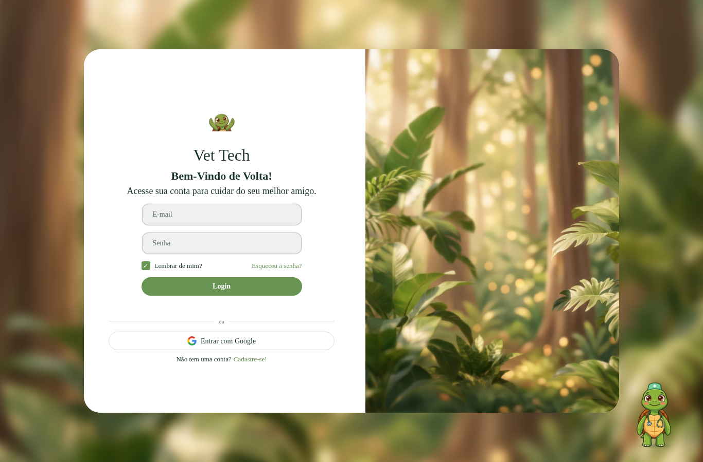
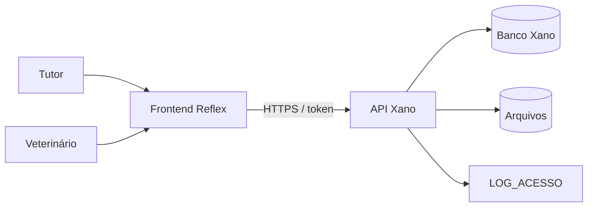
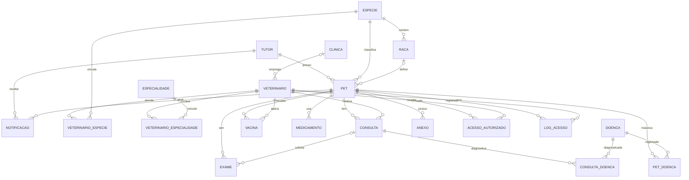
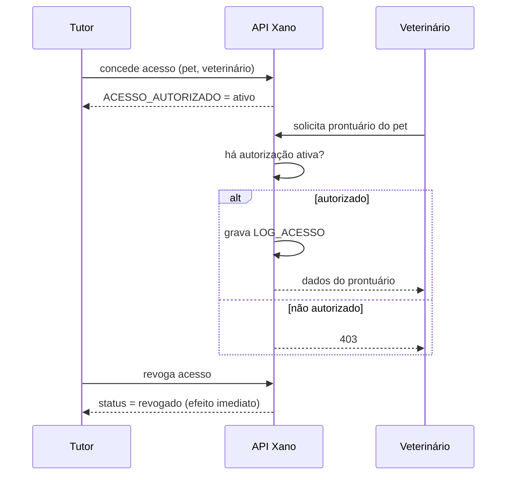

# 🐾 VetTech

> Prontuário digital para acompanhar a saúde dos pets ao longo da vida.


## 1. Apresentação

O **VetTech** é um aplicativo web acadêmico para organizar os cuidados de saúde dos pets. Informações guardadas em cadernetas, arquivos e sistemas de clínicas diferentes podem dificultar a continuidade do atendimento. O prontuário digital reúne os registros publicados de cada animal, permitindo que a pessoa tutora acompanhe sua saúde e que veterinários autorizados consultem o histórico antes de registrar um atendimento. Clínicas podem administrar seus profissionais e pets destinados à adoção.

## 2. Acesso ao aplicativo

Não há endereço público do aplicativo ou landing page confirmado nos arquivos desta versão. Para executar o aplicativo no próprio computador, consulte [Como rodar localmente](#como-rodar-localmente); o endereço local padrão é `http://localhost:3000/`.

Na tela de login, informe e-mail e senha e clique em **Login**. O sistema identifica o perfil automaticamente. Para criar uma conta, clique em **Cadastre-se!**, escolha **Tutor** ou **Veterinário** em **Perfil a cadastrar**, preencha os dados solicitados e conclua o cadastro. O tutor informa CPF e endereço; o veterinário informa CRMV, UF, espécies atendidas e especialidades. A opção de acesso ou cadastro com Google depende da configuração do ambiente.

A conta administrativa de **Clínica** é criada pela equipe responsável pela plataforma; não há cadastro público desse perfil. O administrador entra pelo mesmo formulário. Uma clínica também pode cadastrar um novo veterinário com senha provisória ou convidar uma conta existente em **Veterinários**; a conta existente deve aceitar o convite antes do vínculo.



*Captura de demonstração da tela de acesso; a disponibilidade do botão Google depende da configuração.*

## 3. Perfis de usuários

| Perfil | O que pode fazer | Autorização e limites |
|---|---|---|
| **Tutor** | Cadastrar e selecionar seus pets; agendar consultas; acompanhar registros publicados, permissões e acessos; exportar uma consulta em PDF; consultar pets disponíveis para adoção. | Controla o acesso de veterinários ao prontuário de seus pets e pode revogá-lo. Ao confirmar um agendamento, libera previamente o histórico ao profissional escolhido. |
| **Veterinário** | Consultar agenda e histórico autorizado; iniciar, registrar e finalizar atendimentos; registrar vacinas, medicamentos, doenças e exames; exportar consultas finalizadas. | A leitura, o atendimento e a exportação dependem de autorização ativa do tutor; a revogação impede o acesso. |
| **Clínica** | Consultar e administrar veterinários vinculados; cadastrar pets sob sua responsabilidade e publicar ou retirar anúncios de adoção. | A administração da clínica não concede acesso automático a prontuários. O acesso clínico é individual e depende da autorização do tutor. |

## 4. Funcionalidades

- Cadastro e autenticação de tutores e veterinários, com acesso administrativo provisionado para clínicas.
- Cadastro, seleção e consulta dos dados de pets; painel com resumo dos registros disponíveis.
- Agendamento de consulta e agenda veterinária; rascunho, finalização e publicação do atendimento.
- Prontuário com consultas, vacinas, medicamentos, doenças, diagnósticos e exames, incluindo resultado em texto.
- Consulta de permissões e histórico de acessos, com autorização e revogação pelo tutor.
- Prévia e download em PDF de uma consulta finalizada, para o tutor e o veterinário autorizado.
- Cadastro e publicação de pets para adoção pela clínica, consulta e confirmação de adoção pelo tutor.

## 5. Manual de utilização

### Tutor: pet, consulta e PDF

1. Entre como tutor e abra **Meus Pets**. Para um animal novo, preencha nome e espécie em **Cadastrar pet**, acrescente os demais dados e foto se desejar e clique em **Cadastrar pet**. Para um pet existente, use **Abrir** seguido do nome ou selecione-o em **Mudar pet**. O pet passa a ser o contexto das consultas e do prontuário.
2. No **Dashboard**, clique em **Agendar consulta**. Escolha pet, veterinário compatível, dia e horário; clique em **Continuar**. Informe o motivo e clique em **Confirmar agendamento**. A reserva aparece nas consultas e o veterinário escolhido recebe acesso prévio ao histórico desse pet.
3. Após o veterinário finalizar o atendimento, selecione o pet, abra **Consultas** e clique em **Ver prontuário** na consulta desejada. O atendimento publicado e seus registros ficam disponíveis à pessoa tutora.
4. No prontuário da consulta, clique em **Exportar PDF**, confira a prévia e clique em **Baixar PDF**. O documento baixado corresponde à consulta selecionada.
5. Para conferir ou revogar acesso, em **Consultas** clique em **Carregar permissões e histórico de acessos** e abra **Permissões e histórico de acessos**. Use **Revogar** ao lado do profissional; a revogação interrompe seu acesso ao prontuário.

### Veterinário: agenda e atendimento

1. Entre como veterinário e abra **Horários** para consultar o dia desejado ou **Consultas** para localizar próximas consultas e pendências. Não há configuração de disponibilidade individual nesta versão; o tutor escolhe um horário permitido no agendamento.
2. Localize o agendamento e clique em **Iniciar atendimento**; se já estiver aberto, use **Retomar atendimento**. Com autorização ativa, abra **Consultar histórico anterior** para verificar os registros publicados antes de preencher o atendimento.
3. Em **Dados do atendimento**, informe data, motivo e diagnóstico; preencha observações e retorno quando necessário. Em **Registros clínicos**, use **Adicionar** em **Vacinas**, **Medicamentos**, **Doenças** ou **Exames** e preencha os campos pertinentes. Para um exame realizado, informe o tipo, estado, datas e resultado em texto.
4. Use **Salvar rascunho** se ainda precisar editar. Quando os dados estiverem completos, clique em **Terminar consulta**. O atendimento finalizado e seus complementos são publicados para o tutor; a confirmação também oferece **Exportar PDF** quando elegível.

### Clínica e tutor: adoção

1. Como clínica, abra **Pets para adoção**, preencha **Cadastrar pet para adoção** e clique em **Cadastrar pet**. O pet aparece em **Pets cadastrados** inicialmente sem publicação.
2. No card do pet, clique em **Publicar** e depois em **Confirmar**. Para cancelar a disponibilidade, use **Retirar** e confirme.
3. Como tutor, abra **Adoção**. Os cards mostram os pets disponíveis e um resumo clínico compartilhado; **Ver prontuário** abre apenas a prévia disponibilizada para adoção. Clique em **Adotar** e, no diálogo, em **Confirmar adoção**.
4. No modo persistente, se o backend confirmar a adoção, a responsabilidade passa ao tutor e o pet aparece em **Meus Pets** e **Mudar pet**. No modo demonstrativo local, os cards são fictícios e a confirmação só simula a adoção durante a sessão: não grava no Xano nem inclui o pet nas listas reais.

## 6. Exemplo de utilização

Jade é uma **jiboia fictícia**, assim como todas as informações clínicas deste exemplo. Sua tutora cadastra Jade em **Meus Pets**, seleciona **Jiboia** e usa **Agendar consulta** para escolher um veterinário que atenda essa espécie. Ao confirmar, ela libera previamente o histórico ao profissional escolhido.

O veterinário localiza a reserva em **Consultas**, inicia o atendimento e abre **Consultar histórico anterior** para ler os registros já publicados e autorizados. Em **Exames**, adiciona um exame fictício de acompanhamento, seleciona o estado de realizado e registra um resultado textual fictício. Depois de preencher data, motivo e diagnóstico, escolhe **Terminar consulta**.

A tutora volta a **Consultas**, abre **Ver prontuário** na consulta finalizada e encontra o resultado publicado. Se desejar, usa **Exportar PDF** e **Baixar PDF** para guardar o documento dessa consulta.

## 7. Limitações conhecidas

- A exportação e a prévia de PDF exigem consulta finalizada e acesso autorizado; o documento contém o recorte da consulta escolhida, não um PDF de todo o histórico. Para o veterinário, a autorização deve permanecer ativa. Falhas de acesso ou auditoria impedem a liberação.
- O rascunho do atendimento não é exibido ao tutor; os registros se tornam visíveis após a finalização. Um veterinário sem autorização ativa não pode acessar o prontuário, e o perfil de clínica não recebe acesso clínico automático.
- Não há configuração de disponibilidade individual pelo veterinário nesta versão. O agendamento apresenta a faixa de 08h a 17h e está sujeito às validações e aos conflitos de horário do backend.
- A adoção depende do modo e do backend configurados. Com `VET_TECH_ADOPTION_DEMO=true`, a confirmação é somente uma simulação local; no modo persistente, a transferência depende da confirmação do backend.
- O envio de código ao Git não publica automaticamente as APIs Xano. Funcionalidades dependem dos contratos correspondentes estarem publicados no ambiente utilizado.

Consulte também o [guia rápido](docs/guia-rapido.md) e o [guia de exportação em PDF](docs/guia-exportar-pdf.md).

---

# Informações para desenvolvedores

## 🏗️ Arquitetura

| Camada | Tecnologia | Responsabilidade |
|---|---|---|
| Banco de dados | **Xano** | Tabelas, relacionamentos e integridade |
| Backend / API | **Xano (xanoscript)** | Regras de negócio, autenticação, validações e autorização |
| Frontend | **Python + Reflex** | Interface web responsiva com dashboards distintos para tutor e veterinário |
| Arquivos | URL/arquivo vinculado ao pet | Exames, laudos, receitas e fotos |



---

## 🗃️ Modelo de dados

> **Fonte de verdade:** o modelo de dados (DER) e o xanoscript em [`/xano`](./xano). Toda alteração na modelagem deve ser refletida no diagrama e no script.



Detalhes de cada entidade, campos e regras estão em [`docs/domain-model.md`](./docs/domain-model.md).

---

## 🔐 Permissões, auditoria e LGPD

- O **tutor** é o único que concede ou revoga o acesso de veterinários ao prontuário do seu pet.
- O **veterinário** só visualiza, edita ou exporta dados de pets com autorização **ativa**; ao ser revogada, o acesso é perdido imediatamente.
- Operações clínicas protegidas e exportações geram registros de auditoria no backend conforme os contratos implementados.
- Senhas são armazenadas com **hash**, nunca em texto puro.
- O controle de acesso e a auditoria são aplicados no backend; detalhes estão em [fluxo clínico](docs/clinical-flow.md).



---

## 🧭 Spec-Driven Development com OpenSpec

Este projeto é desenvolvido com **Spec-Driven Development (SDD)**: primeiro a especificação, depois o código. Usamos o [OpenSpec](https://github.com/Fission-AI/OpenSpec) para propor, validar e arquivar mudanças, com apoio de agentes de IA.

### Como funciona

1. **Explorar:** entender o problema e o código atual antes de mudar algo.
2. **Propor:** criar uma mudança em `openspec/changes/<nome-da-mudanca>/` com proposta, design e tarefas.
3. **Aplicar:** implementar as tarefas seguindo a especificação.
4. **Sincronizar:** atualizar as specs principais em `openspec/specs/` com o que foi definido.
5. **Arquivar:** mover a mudança concluída para `openspec/changes/archive/`.

### Skills de agente disponíveis

As skills ficam em [`.github/skills`](./.github/skills):

| Skill | Para que serve |
|---|---|
| `openspec-explore` | Explorar ideias e investigar o projeto |
| `openspec-propose` | Propor uma nova mudança com artefatos de especificação |
| `openspec-apply-change` | Implementar as tarefas de uma mudança |
| `openspec-update-change` | Ajustar uma mudança em andamento |
| `openspec-sync-specs` | Sincronizar as specs principais |
| `openspec-archive-change` | Arquivar uma mudança concluída |

> As instruções para agentes de IA estão em [`AGENTS.md`](./AGENTS.md) e [`CLAUDE.md`](./CLAUDE.md).

---

## 📁 Estrutura do repositório

```text
vet-tech/
├── .github/            # Prompts, skills e workflows (OpenSpec / Copilot)
├── assets/             # Arquivos estáticos (ex.: favicon)
├── docs/               # Documentação do projeto e modelo de domínio
├── openspec/           # Especificações (SDD): specs/ e changes/
├── vet_tech/           # Frontend em Reflex
├── xano/               # xanoscript e artefatos do backend
├── AGENTS.md           # Instruções para agentes de IA
├── CLAUDE.md           # Instruções para o Claude
├── requirements.txt    # Dependências Python
├── rxconfig.py         # Configuração do Reflex
└── README.md
```

| Documento | Conteúdo |
|---|---|
| [`docs/project-overview.md`](./docs/project-overview.md) | Visão geral do projeto |
| [`docs/domain-model.md`](./docs/domain-model.md) | Entidades, relacionamentos e regras de domínio |
| [`docs/DOCUMENTACAO.md`](./docs/DOCUMENTACAO.md) | Documentação completa (requisitos, regras de negócio, arquitetura) |

---

## Como rodar localmente

### Pré-requisitos

- Python 3.11 ou superior
- Git
- Uma conta no [Xano](https://www.xano.com/) com o workspace do projeto configurado

### Passo a passo

```bash
# 1. Clone o repositório
git clone https://github.com/sabortech/vet-tech.git
cd vet-tech

# 2. Crie e ative o ambiente virtual
python -m venv .venv
source .venv/bin/activate        # Linux/macOS
# .venv\Scripts\activate         # Windows

# 3. Instale as dependências
pip install -r requirements.txt

# 4. Configure a origem do workspace de desenvolvimento
cp .env.example .env
# Edite XANO_API_BASE_URL no .env antes de continuar.

# 5. Inicie frontend e backend juntos (carrega .env automaticamente)
bash scripts/run-local.sh
```

O endereço padrão é http://localhost:3000/, com frontend e backend na mesma
porta. Para usar outra porta, execute `VET_TECH_PORT=3001 bash scripts/run-local.sh`.
Use esse launcher para carregar o `.env` e iniciar ambos os serviços; uma tela
aberta sem conexão de eventos com o backend não consegue processar login.
Consulte no log o endereço e a porta usados pela aplicação.

### Configuração do backend (Xano)

Defina `XANO_API_BASE_URL` no ambiente com a origem HTTP(S) do workspace, sem
`/api:grupo`, credenciais ou parâmetros. O cliente em `shared/xano_client.py`
compõe os grupos e endpoints. Não há fallback para outro workspace: o backend
interrompe a inicialização quando a configuração falta ou é inválida. Imports e
compilação não exigem conexão Xano. O `.env` é local e ignorado pelo Git;
a configuração compartilhada o carrega automaticamente, preservando variáveis já
definidas no ambiente. `.env.example` usa uma origem fictícia. Reinicie a aplicação
após editar o `.env`.

No Windows (PowerShell), também é possível iniciar diretamente da raiz:

```powershell
.\.venv\Scripts\reflex.exe run --env prod --single-port
```

Os artefatos oficiais estão em [`xano/`](./xano). Antes de publicar mudanças,
revise o [contrato e plano de migração](./docs/backend-foundation.md).

### Verificações

```bash
python -m unittest discover -s tests/unit -v
reflex compile --dry
openspec validate --all --strict
git diff --check
```

Os testes unitários usam configuração fictícia e transporte HTTP simulado,
sem acessar Xano. Integrações reais ficam em `tests/integration` e exigem
execução explícita contra desenvolvimento, conforme seus docstrings. Não use
dados ou tokens de produção. Testes locais não comprovam autorização e auditoria
de endpoints ainda não implementados.

> ⚠️ A pasta `reflex.lock` é gerada automaticamente pelo Reflex e não deve ser versionada.

---

## 🗺️ Estratégia de desenvolvimento

Desenvolvimento incremental por módulo:

1. Modelagem do banco (DER e xanoscript)
2. Definição da arquitetura (backend/frontend)
3. Cadastro → prontuário → permissões → notificações
4. Testes com dados simulados (mock data)
5. Ajustes de usabilidade nas telas do tutor e do veterinário
6. Documentação final para entrega acadêmica

### Princípios de modelagem

- Modelagem orientada ao usuário final: pet e tutor no centro, não a clínica.
- Normalização para evitar inconsistências (espécie/raça padronizadas).
- Tabelas associativas para relações N:N (Pet-Doença, Consulta-Doença).
- Documentação incremental do modelo conforme surgem novas necessidades.

---

## 📚 Glossário

| Termo | Significado |
|---|---|
| Tutor | Responsável legal e dono dos dados do pet |
| CRMV | Registro profissional do médico-veterinário |
| SRD | Sem raça definida |
| Prontuário | Histórico médico consolidado do pet |
| Diagnóstico pontual | Doença identificada em uma consulta específica |
| Histórico consolidado | Situação das doenças do pet ao longo do tempo |
| DER | Diagrama entidade-relacionamento |
| SDD | Spec-Driven Development |
| LGPD | Lei Geral de Proteção de Dados |

---

## 🤝 Contribuindo

1. Crie uma branch a partir da `main`: `git checkout -b feat/nome-da-mudanca`
2. Proponha a mudança com o OpenSpec **antes** de implementar.
3. Implemente seguindo a especificação e mantenha o DER e o xanoscript consistentes.
4. Faça commits claros e abra um Pull Request.

## 👨‍💻 Equipe

<div align="center">

<table>
  <tr>
    <td align="center" width="200">
      <a href="https://github.com/7offdvx">
        
      </a>
      <br /><br />
      <b>@7offdvx</b>
      <br /><br />
      <a href="https://github.com/7offdvx">
        
      </a>
    </td>
    <td align="center" width="200">
      <a href="https://github.com/danikellyalves">
        
      </a>
      <br /><br />
      <b>@danikellyalves</b>
      <br /><br />
      <a href="https://github.com/danikellyalves">
        
      </a>
    </td>
    <td align="center" width="200">
      <a href="https://github.com/vitor0sousa">
        
      </a>
      <br /><br />
      <b>@vitor0sousa</b>
      <br /><br />
      <a href="https://github.com/vitor0sousa">
        
      </a>
    </td>
  </tr>
</table>

<br />

<a href="https://github.com/sabortech/vet-tech/graphs/contributors">
  
</a>

<sub>Feito com 💚 por quem acredita que todo pet merece um histórico de saúde completo 🐾</sub>

</div>

## 🐢 Nosso mascote
<div align="center"> <table> <tr> <td align="center" width="280">  <br /><br /> <b>O cuidador</b> <br /> <sub>Sempre pronto para receber tutores e pets de braços abertos.</sub> </td> <td align="center" width="280">  <br /><br /> <b>O organizador</b> <br /> <sub>Cuida de cada anotação para o histórico do pet nunca se perder.</sub> </td> </tr> </table> <br />
<i>Uma tartaruga atenta, calma e cuidadosa, como o prontuário que acompanha o pet por toda a vida.</i>

</div>

## 🎓 Instituição

<div align="center">

<a href="https://www.impacta.edu.br">
  
</a>

<br /><br />

### Faculdade Impacta e Tecnologia (FIT)

*Projeto acadêmico desenvolvido com foco em tecnologia, inovação e aplicação prática.*

<br />

<a href="https://www.impacta.edu.br">
  
</a>


</div>

---

## 📄 Licença

<!-- Defina a licença do projeto (ex.: MIT) -->
© Projeto desenvolvido para fins acadêmicos.

Faculdade Impacta e Tecnologia (FIT)
# Verificação do backend clínico

Contratos dos endpoints, decisões de identidade, preparo de
fixtures e testes reais do Xano estão em
[`docs/record-foundation-verification.md`](docs/record-foundation-verification.md).
A suíte remota é separada dos testes unitários e exige configuração explícita
de um ambiente de desenvolvimento; não usa fallback para produção.
