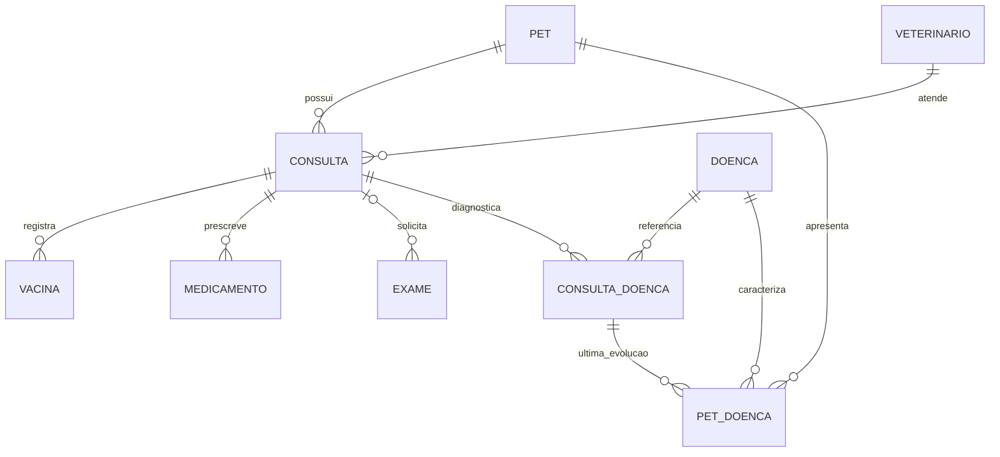

# Fluxo clínico — contrato implementado

Change: `openspec/changes/fluxo-consultas-prontuario/`. Backend publicado no workspace 167758; interface integrada e verificada localmente. Evidências em `verification.md` e `smoke-result.json` dessa change. Sem publicação do frontend em hospedagem externa.

Consulta passa a representar a reserva e o atendimento com estados agendada, em atendimento e finalizada. Horário reservado, início/fim reais e data clínica são campos distintos. O tutor agenda no dashboard em diálogo de duas etapas; o veterinário acessa Horários (calendário vertical) e Consultas (próximas/pendências), de onde começa o atendimento. Não há bloqueio do início pelo relógio.

Os novos vínculos de consulta a pet e profissional são exigidos pelo backend; campos legados permanecem preservados na migração aditiva. O rascunho é interno, versionado e não aparece ao tutor. Publicação e auditoria devem concluir na mesma transação antes de expor os complementos.

## Relações clínicas

`doenca` é catálogo reutilizável; `consulta_doenca` é o diagnóstico/evolução datado em um atendimento, com autoria; `pet_doenca` é o estado individual mais recente do par pet/doença. Uma consulta retroativa publicada depois não deve substituir uma evolução de data clínica mais recente. Registros legados em `doenca.pet_id` não são fundidos nem movidos por aproximação de nome.

No schema de exame, o attachment continua único, público e opcional, com tipo e conteúdo preservados. A anulabilidade é explícita para a nova solicitação estruturada sem arquivo (`attachment? arquivo?`); não transformar ausência de arquivo em documento fictício. O importador Xano já normaliza attachment opcional como anulável. As tentativas de restaurar metadados pela API JSON foram abandonadas porque removiam os filtros trim de texto; o schema canônico restaura esses filtros. Nenhum campo foi excluído e nenhum arquivo anterior foi removido.

Vacina mantém aplicação/lote/próxima dose. Medicamento recebe dose decimal com unidade, frequência, via, período, autoria e origem sem converter destrutivamente a dosagem antiga. Exame registra solicitação, realização e resultado textual; a solicitação não exige arquivo nem resultado, e exames avulsos/arquivos legados permanecem. Documentos e uploads não integram esta entrega.

## Migração e rollback

Inventário somente de leitura: `scripts/clinical_inventory.py`; snapshots e digests ficam em `.venv/clinical-inventory/`, sem dados de saúde no Git. Nesta primeira captura, as sete tabelas clínicas/permissões estão vazias. Não há backfill clínico a executar nem vínculo a inventar; se o estado remoto mudar, repetir a análise antes da implantação.

Os schemas preservam os campos anteriores, inclusive `doenca.pet_id`, datas sem hora e dosagem inteira. O catálogo novo usa uma chave normalizada anulável para preservar legado não mapeado. Índices compostos impedem duplicação das linhas por consulta e do estado individual por pet/doença. `clinical_lock` é tabela técnica temporária: inserir/remover a mesma chave por pet dentro de uma transação serializa operações de autorização e publicação; falhas revertem a trava. Não oferecer APIs públicas para essa tabela.

A criação de reserva também adquire primeiro a chave técnica zero nessa mesma tabela e a remove antes do commit. Zero não representa um pet: serializa apenas a criação de reservas no MVP para verificar conflitos antes do insert. As operações clínicas/consentimento continuam usando a chave positiva do pet. Os índices únicos permanecem como garantia adicional. Disputas retornam erro de negócio sem revelar a reserva concorrente; não retornar erro interno por disputa normal de horário.

Rollback do código não exclui consultas, rascunhos, condições, logs ou arquivos antigos. Se houver conflito de legado ou mudanças posteriores no banco, bloquear migração e preparar reconciliação específica. Nunca truncar nem restaurar snapshot antigo sobre histórico criado depois.

## API preparada

Grupo `vettech-clinical`; autenticação derivada exclusivamente do token da tabela `tutor` ou `veterinario`. Nenhuma rota de escrita de log, alteração de pet/autoria, exclusão de consulta ou reabertura é oferecida.

| Perfil | Método e rota | Entrada/retorno |
| --- | --- | --- |
| Tutor | GET `tutor/profissionais` | `pet_id` próprio; IDs, nome e CRMVs dos compatíveis |
| Tutor | POST `tutor/consultas` | `payload`: dia, horario, pet_id, veterinario_id, motivo, operacao; retorna ID/estado |
| Tutor | GET `tutor/consultas` | `pet_id`; reservas e cabeçalhos publicados, sem rascunho |
| Tutor | GET `tutor/pets/{pet_id}/historico` | Consultas publicadas e mesmos complementos/IDs das seções |
| Tutor | GET `tutor/pets/{pet_id}/acessos` | Autorizações do pet próprio |
| Tutor | PUT `tutor/pets/{pet_id}/acessos/{acesso_id}` | `status` ativo/revogado; valida vínculo pet/autorização |
| Tutor | GET `tutor/pets/{pet_id}/auditoria` | Logs mínimos do pet próprio; somente leitura |
| Veterinário | GET `veterinario/agenda` | `dia` ISO opcional, `page` a partir de 1; 25 registros/página em ordem de início; sem dia reúne pendências de todos os dias |
| Veterinário | POST `veterinario/consultas/{consulta_id}/iniciar` | Começa agendada ou retoma aberta; não verifica relógio |
| Veterinário | GET `veterinario/consultas/{consulta_id}/rascunho` | Consulta atribuída e pet autorizado; audita leitura |
| Veterinário | PUT `veterinario/consultas/{consulta_id}/rascunho` | `versao`, `payload`; retorna ID/estado/versão atualizada |
| Veterinário | POST `veterinario/consultas/{consulta_id}/finalizar` | `versao`, `payload`; publica transacionalmente; repetição retorna mesma consulta |
| Veterinário | GET `veterinario/pets/{pet_id}/historico` | Dados básicos e histórico publicado, com consentimento e auditoria |
| Veterinário | GET `veterinario/pets/{pet_id}/doencas` | Referências de catálogo sem associação legada individual |
| Veterinário | POST `veterinario/pets/{pet_id}/doencas` | `payload.nome`, descrição opcional; reutiliza referência normalizada existente sem sobrescrevê-la |

Payload clínico: motivo, diagnostico, obs, data_atendimento, retorno_previsto e listas vacinas/medicamentos/doencas/exames. Cada linha tem `linha_id` estável gerado no formulário. Dono, pet, autoria, consulta e estado não são editáveis no payload; tentativa explícita é rejeitada. Rascunho aceita complementos incompletos; finalizar exige data/motivo/diagnóstico e valida todas as linhas incluídas, indicando grupo/posição do erro. Datas de aplicação e realização não podem ser futuras; retorno e próxima dose são previsões independentes.

O backend usa `inputerror` para validação/estado/versão, `notfound` para referência fora da responsabilidade/propriedade e acesso negado para consentimento ausente. Disputas reais de horário retornaram 400 com mensagem de negócio e um único vencedor. Erros internos/timeout não comprovam rejeição: o frontend conserva a chave da reserva e reconcilia a versão do atendimento antes de reenviar. A assinatura idempotente não muda com o relógio; uma reserva já confirmada pode ser recuperada depois de seu horário, enquanto uma reserva nova no passado é rejeitada. Somente 429 recebe espera/repetição automática limitada; timeout/5xx exigem reconciliação explícita.

## Composição e verificação

`ClinicalMixin` é composto à única `State` autenticada; usa seu token e contador de sessão. Logout/expiração limpam agenda, atendimento, histórico e modal. Troca de pet limpa as seções e invalida respostas antigas sem modificar a seleção independente do modal. Buscas de profissionais e histórico prévio têm contadores próprios para descartar respostas ultrapassadas. Dados clínicos permanecem somente no servidor da sessão, sem armazenamento de token em componente ou sessão paralela.

O percurso remoto, as fixtures propostas e os limites da publicação estão em `openspec/changes/fluxo-consultas-prontuario/deployment-review.md`. Testes locais de validação/projeção executam as Lambdas JavaScript reais; testes de estado usam HTTP mockado. Compilação e dry-run não substituem testes de transação, identidade e navegador.
