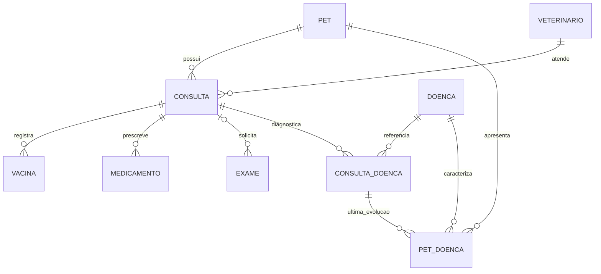

# Fluxo clínico — contrato implementado

Change: `openspec/changes/fluxo-consultas-prontuario/`. Backend publicado no workspace 167758; interface integrada e verificada localmente. Evidências em `verification.md` e `smoke-result.json` dessa change. Sem publicação do frontend em hospedagem externa.

Consulta passa a representar a reserva e o atendimento com estados agendada, em atendimento e finalizada. Horário reservado, início/fim reais e data clínica são campos distintos. O tutor agenda no dashboard em diálogo de duas etapas; o veterinário acessa Horários (calendário vertical) e Consultas (próximas/pendências), de onde começa o atendimento. Não há bloqueio do início pelo relógio.

Os novos vínculos de consulta a pet e profissional são exigidos pelo backend; campos legados permanecem preservados na migração aditiva. O rascunho é interno, versionado e não aparece ao tutor. Publicação e auditoria devem concluir na mesma transação antes de expor os complementos.

## Relações clínicas

`doenca` é catálogo reutilizável; `consulta_doenca` é o diagnóstico/evolução datado em um atendimento, com autoria; `pet_doenca` é o estado individual mais recente do par pet/doença. Uma consulta retroativa publicada depois não deve substituir uma evolução de data clínica mais recente. Registros legados em `doenca.pet_id` não são fundidos nem movidos por aproximação de nome.

No schema de exame, o attachment continua único, público e opcional, com tipo e conteúdo preservados. A anulabilidade é explícita para a nova solicitação estruturada sem arquivo (`attachment? arquivo?`); não transformar ausência de arquivo em documento fictício. O importador Xano já normaliza attachment opcional como anulável. As tentativas de restaurar metadados pela API JSON foram abandonadas porque removiam os filtros trim de texto; o schema canônico restaura esses filtros. Nenhum campo foi excluído e nenhum arquivo anterior foi removido.

Vacina mantém aplicação/lote/próxima dose. Medicamento recebe dose decimal com unidade, frequência, via, período, autoria e origem sem converter destrutivamente a dosagem antiga. Exame registra solicitação, realização e resultado textual; a solicitação não exige arquivo nem resultado, e exames avulsos/arquivos legados permanecem. Documentos e uploads não integram esta entrega.

## Migração e rollback

Inventário somente de leitura: `scripts/clinical_inventory.py`; snapshots e digests ficam em `.venv/clinical-inventory/`, sem dados de saúde no Git. Nesta primeira captura, as sete tabelas clínicas/permissões estão vazias. Não há backfill clínico a executar nem vínculo a inventar; se o estado remoto mudar, repetir a análise antes da implantação.

Os schemas preservam os campos anteriores, inclusive `doenca.pet_id`, datas sem hora e dosagem inteira. O catálogo novo usa uma chave normalizada anulável para preservar legado não mapeado. Índices compostos impedem duplicação das linhas por consulta e do estado individual por pet/doença. `clinical_lock` é tabela técnica temporária: inserir/remover a mesma chave por pet dentro de uma transação serializa operações de autorização e publicação; falhas revertem a trava. Não oferecer APIs públicas para essa tabela.

A criação de reserva também adquire primeiro a chave técnica zero nessa mesma tabela e a remove antes do commit. Zero não representa um pet: serializa apenas a criação de reservas no MVP para verificar conflitos antes do insert. As operações clínicas/consentimento continuam usando a chave positiva do pet. Os índices únicos permanecem como garantia adicional. Disputas retornam erro de negócio sem revelar a reserva concorrente; não retornar erro interno por disputa normal de horário.

Rollback do código não exclui consultas, rascunhos, condições, logs ou arquivos antigos. Se houver conflito de legado ou mudanças posteriores no banco, bloquear migração e preparar reconciliação específica. Nunca truncar nem restaurar snapshot antigo sobre histórico criado depois.

## API preparada

Grupo `vettech-clinical`; autenticação derivada exclusivamente do token da tabela `tutor` ou `veterinario`. Nenhuma rota de escrita de log, alteração de pet/autoria, exclusão de consulta ou reabertura é oferecida.

| Perfil | Método e rota | Entrada/retorno |
| --- | --- | --- |
| Tutor | GET `tutor/profissionais` | `pet_id` próprio; IDs, nome e CRMVs dos compatíveis |
| Tutor | POST `tutor/consultas` | `payload`: dia, horario, pet_id, veterinario_id, motivo, operacao; retorna ID/estado |
| Tutor | GET `tutor/consultas` | `pet_id`; reservas e cabeçalhos publicados, sem rascunho |
| Tutor | GET `tutor/pets/{pet_id}/historico` | Consultas publicadas e mesmos complementos/IDs das seções |
| Tutor | GET `tutor/pets/{pet_id}/acessos` | Autorizações do pet próprio |
| Tutor | PUT `tutor/pets/{pet_id}/acessos/{acesso_id}` | `status` ativo/revogado; valida vínculo pet/autorização |
| Tutor | GET `tutor/pets/{pet_id}/auditoria` | Logs mínimos do pet próprio; somente leitura |
| Veterinário | GET `veterinario/agenda` | `dia` ISO opcional, `page` a partir de 1; 25 registros/página em ordem de início; sem dia reúne pendências de todos os dias |
| Veterinário | POST `veterinario/consultas/{consulta_id}/iniciar` | Começa agendada ou retoma aberta; não verifica relógio |
| Veterinário | GET `veterinario/consultas/{consulta_id}/rascunho` | Consulta atribuída e pet autorizado; audita leitura |
| Veterinário | PUT `veterinario/consultas/{consulta_id}/rascunho` | `versao`, `payload`; retorna ID/estado/versão atualizada |
| Veterinário | POST `veterinario/consultas/{consulta_id}/finalizar` | `versao`, `payload`; publica transacionalmente; repetição retorna mesma consulta |
| Veterinário | GET `veterinario/pets/{pet_id}/historico` | Dados básicos e histórico publicado, com consentimento e auditoria |
| Veterinário | GET `veterinario/pets/{pet_id}/doencas` | Referências de catálogo sem associação legada individual |
| Veterinário | POST `veterinario/pets/{pet_id}/doencas` | `payload.nome`, descrição opcional; reutiliza referência normalizada existente sem sobrescrevê-la |

Payload clínico: motivo, diagnostico, obs, data_atendimento, retorno_previsto e listas vacinas/medicamentos/doencas/exames. Cada linha tem `linha_id` estável gerado no formulário. Dono, pet, autoria, consulta e estado não são editáveis no payload; tentativa explícita é rejeitada. Rascunho aceita complementos incompletos; finalizar exige data/motivo/diagnóstico e valida todas as linhas incluídas, indicando grupo/posição do erro. Datas de aplicação e realização não podem ser futuras; retorno e próxima dose são previsões independentes.

O backend usa `inputerror` para validação/estado/versão, `notfound` para referência fora da responsabilidade/propriedade e acesso negado para consentimento ausente. Disputas reais de horário retornaram 400 com mensagem de negócio e um único vencedor. Erros internos/timeout não comprovam rejeição: o frontend conserva a chave da reserva e reconcilia a versão do atendimento antes de reenviar. A assinatura idempotente não muda com o relógio; uma reserva já confirmada pode ser recuperada depois de seu horário, enquanto uma reserva nova no passado é rejeitada. Somente 429 recebe espera/repetição automática limitada; timeout/5xx exigem reconciliação explícita.

## Composição e verificação

### Carregamento do tutor por pet

O Prontuário usa a sidebar personalizada compartilhada com Meus Pets e
Configurações. A entrada Prontuário abre Início; Vacinas, Medicamentos, Doenças e
Consultas são links com `secao` na mesma rota. Navegar entre essas áreas preserva
o pet autorizado. Sem seleção, a intenção da seção é mantida enquanto a pessoa
escolhe um animal. Query desconhecida abre Início. Voltar/avançar reaplica a seção
da URL e reutiliza o cache clínico quando válido.

Novo pet abre/fecha o modal sem redirecionar para login; Mudar pet mantém a
limpeza de contexto existente. A sidebar não inicia consultas por expansão ou
renderização. O drawer móvel fecha após a navegação; Configurações com edição
pendente só executa o destino exato depois de confirmar descarte.

Selecionar explicitamente um pet agenda a consulta de seus dados básicos em
background. Após a confirmação de propriedade, histórico publicado e reservas
são consultados em paralelo (duas leituras clínicas por carga). O detalhe pode
consultar o catálogo de raças se o nome não estiver disponível. HTTP ocorre
fora do bloqueio do estado Reflex; menu, configurações, troca de pet e saída
continuam disponíveis durante a espera, inclusive ao aguardar retry de 429.

Vacinas, Medicamentos, Doenças e Consultas reutilizam o conjunto confirmado
por até 60 segundos na seleção atual. Entrar novamente na área do pet ou trocar
de seção depois desse prazo agenda revalidação. Não há polling. “Atualizar dados
do pet” força a atualização clínica; durante uma carga já iniciada, não cria
outra. Os dados básicos podem ser revalidados ao voltar à lista/abrir o pet.
Permissões e histórico de acessos são carregados pelo botão próprio em Consultas,
com estados de loading e falha independentes; não fazem parte da carga inicial.

O loading apresenta spinner/skeleton e texto acessível na área do conteúdo,
sem bloquear o menu. Estado vazio só aparece depois do sucesso. Falha de rede
mantém o detalhe básico autorizado e oferece nova tentativa; 401 expira a sessão
e 403/404 eliminam o contexto protegido. Trocar de pet, voltar à lista e sair
invalidam cargas antigas; elas não podem alterar dados, mensagens ou loading.

O cache pertence somente ao pet e à sessão atual no servidor. Não é gravado no
navegador nem compartilhado entre contas. Um agendamento confirmado para o pet
atual revalida reservas; consentimento confirmado revalida permissões e auditoria,
invalidando respostas anteriores à escrita. Mudanças externas podem aparecer na
atualização manual ou na próxima navegação após a validade. O fluxo veterinário
mantém suas verificações de autorização e auditoria existentes.

`ClinicalMixin` é composto à única `State` autenticada; usa seu token e contador de sessão. Logout/expiração limpam agenda, atendimento, histórico e modal. Troca de pet limpa as seções e invalida respostas antigas sem modificar a seleção independente do modal. Buscas de profissionais e histórico prévio têm contadores próprios para descartar respostas ultrapassadas. Dados clínicos permanecem somente no servidor da sessão, sem armazenamento de token em componente ou sessão paralela.

O percurso remoto, as fixtures propostas e os limites da publicação estão em `openspec/changes/fluxo-consultas-prontuario/deployment-review.md`. Testes locais de validação/projeção executam as Lambdas JavaScript reais; testes de estado usam HTTP mockado. Compilação e dry-run não substituem testes de transação, identidade e navegador.

### Agenda visual do veterinário

Horários utiliza o layout lateral compartilhado com Horários, Consultas e Configurações.
O calendário seleciona dias no fuso America/Sao_Paulo; a grade inclui horários
externos à faixa inicial 08–17 e empilha reservas sem presumir duração.
O total é do dia; concluídas/em atendimento são contagens da página atual.
`veterinario/agenda` adiciona `pet_foto` opcional (texto base64 ou URL do cadastro)
no ramo de consentimento ativo, junto a `pet_nome`. O ramo revogado continua
sem foto, nome, pet_id ou motivo. A ausência da nova propriedade mantém o fallback
neutro, inclusive enquanto o contrato aditivo não estiver publicado no Xano.
Nenhuma ação para criar reserva ou declarar disponibilidade é introduzida.

O seletor de data da agenda oferece Hoje e um ícone de calendário. O ícone abre
um diálogo mensal em português com seleção de mês/ano e tartaruga decorativa.
Navegar no calendário ou fechar não altera a data ativa nem consulta o backend;
selecionar um dia fecha o diálogo e recarrega a agenda existente, inclusive para
datas passadas. A luz verde gira no sentido horário somente na borda da janela
aberta; a preferência de movimento reduzido diminui a velocidade do traço, mantendo a circulação solicitada.

Os seletores de mês/ano do painel usam listas abaixo dos botões, com chevron
para baixo, altura limitada e rolagem interna. O posicionamento não inverte para
cima; a seleção continua apenas mudando o mês exibido até escolher um dia.

A borda luminosa do calendário usa um segmento SVG no perímetro arredondado,
com deslocamento de traço no sentido horário. Não depende de animação de
propriedade CSS registrada; desacelera em movimento reduzido e não intercepta cliques.

### Retorno após concluir atendimento

Salvar rascunho confirma a gravação em notificação no canto inferior esquerdo e
mantém o formulário aberto. Finalizar com sucesso (inclusive após reconciliação
por resposta perdida) abre Horários no dia de `agendada_para` em America/Sao_Paulo,
independentemente da data clínica editada. A entrada da agenda revalida os dados
no endpoint autenticado existente; o card mostra Concluída, deixa de oferecer
Começar/Retomar e não aparece entre as pendências de Consultas. Falha, conflito
ou resposta de sessão/consulta antiga não declaram conclusão nem redirecionam.

Cards de Horários e Consultas compartilham paleta por estado e identificação textual.
A agenda do dia e a moldura da foto/fallback possuem contorno SVG com luz verde
circulando no sentido horário, sem movimentar conteúdo ou interceptar cliques.
Movimento reduzido desacelera a circulação. O consentimento continua determinando
quais dados e ações podem aparecer no card, conforme o backend.

O atendimento e seus painéis (histórico, calendário clínico, confirmação de descarte e toast) acompanham `data-vt-theme` da preferência existente, inclusive durante a edição e com portais abertos. A troca não recarrega dados nem altera o rascunho; tokens locais `--vet-*` mantêm superfícies, campos, texto e estados de foco legíveis nos dois temas.

Histórico nos cards de Horários e Consultas reutiliza `attendance_history_dialog` do atendimento, com pet e acionador próprios. Erro e nova tentativa pertencem ao modal (`prior_history_message`), mantendo a agenda visível e o rascunho inalterado. Fechar devolve foco ao botão do card. Botões recebem cantos arredondados globalmente; controles de seleção mantêm suas formas próprias.

### Consultas com resumo do paciente

Consultas apresenta lista horizontal e seleção pelo nome/foto, resumo lateral
(no celular, abaixo da lista), filtros e a decoração `babyturtle.png`. Menu e
assistente flutuante preservam a composição existente. O resumo é uma leitura
explícita do endpoint autenticado e auditado de histórico. Atualizar, filtrar,
paginar e sair limpam a seleção; respostas antigas não podem substituir outro pet.

Alergias vêm de nomes de doenças/diagnósticos que identificam alergia, incluindo
estado registrado; não existe campo dedicado no modelo atual. Ausência mostra
“Alergias não informadas”, sem declarar que o pet não possui alergias. Peso mantém
a unidade original não especificada no contrato. O motivo do agendamento é
identificado como motivo, e não como observação do tutor.

O contrato aditivo de `xano/api/clinical/agenda_GET.xs` aceita `aba` (Pendentes,
Hoje, Próximas, Concluídas, Canceladas), `busca` (nome do pet) e `estado` (agendada,
em_atendimento, finalizada, cancelada). Aplica filtros antes da página de 25 itens e
retorna `contrato_consultas: 2` (versão 1 permanece aceita para filtros anteriores). Hoje considera America/Sao_Paulo; Próximas
considera dias após hoje. Sem parâmetros, preserva agenda diária e pendentes.
Busca não considera nomes sem consentimento ativo. Canceladas lista registros com status `cancelada`, excluídos das abas ativas e sem
ações de iniciar/retomar; não introduz operação de cancelamento nem de confirmação.
O campo de busca tem contorno pill e o filtro de estado inclui ícone de ajustes.

**Publicação:** o arquivo da agenda precisa ser publicado no Xano para ativar
os filtros globais. No contrato remoto antigo, Pendentes funciona e filtros novos
mostram aviso explícito em vez de apresentar resultados incorretos. Esta alteração
local não publica o endpoint nem modifica dados reais. Não requer migração de tabelas.

Os cards da seção Consultas reutilizam o SVG perimetral do calendário para
identificar o estado: vermelho em `agendada`, amarelo em `em_atendimento` e
verde em `finalizada`. O segmento percorre o perímetro no sentido horário em
6 segundos, com halo da mesma cor aplicado ao traço por `drop-shadow`.
Movimento reduzido desacelera para 12 segundos. O LED não intercepta cliques;
status textual, seleção e ações continuam disponíveis. Canceladas e estados
não reconhecidos permanecem sem LED. Esta apresentação não altera APIs. O LED da foto em Horários acompanha a cor
do estado; agenda do dia, calendário e assistente mantêm seus LEDs verdes.

O card Resumo do paciente compartilha o mesmo LED, cor e halo da consulta
selecionada. O status acompanha os dados confirmados na leitura autorizada e
usa a mesma proteção de sessão/geração. Durante carregamento, em falha, sem
seleção ou para consulta cancelada, o resumo fica sem LED. A cor refere-se à
consulta selecionada, não a outras consultas do mesmo pet.

A paleta contextual também se aplica a ações, contorno de Ver prontuário,
ícones, nomes, badges, foco, avatar sem foto e fundos suaves dos cards/resumo.
Agendada usa vermelho, em atendimento usa amarelo e finalizada usa verde;
no tema claro, destaques amarelos de texto usam ocre para leitura. Botões
amarelos têm texto escuro. Canceladas, estados desconhecidos e resumo sem
seleção usam neutro. O fallback do avatar é uma patinha vetorial da mesma
paleta, ocultada quando a foto carrega; foto real e babyturtle preservam cores.
Menu, toolbar global e assistente continuam com a identidade existente.

Resumo confirmado e card selecionado usam a mesma mistura de fundo (88% da
superfície do tema e 12% da cor do estado) e a mesma borda de destaque, evitando
tons diferentes entre a lista e o painel do paciente.

Os cards de Horários reutilizam os tokens de cor de Consultas: vermelho para
agendada, amarelo para em atendimento e verde para finalizada. A paleta inclui
borda lateral, nome, ícones, badge, botões, foco e avatar/fallback. O LED circular
da foto segue a mesma cor e halo, preservando sentido horário, 5s por volta e
16s com movimento reduzido. Histórico, início/retomada e consentimento mantêm
seus fluxos existentes.

A faixa lateral dos cards em atendimento em Horários usa amarelo claro #fde047;
textos e ícones mantêm o tom de contraste da paleta contextual.

### Paleta e LED do formulário Atendimento
A página deriva sua classe de `clinical_status` e reutiliza a paleta dos cards:
amarelo em atendimento, vermelho agendada e verde finalizada. Campos, botões,
ícones, superfícies e foco seguem o status, com texto neutro e contraste.
Histórico, calendário e seletores abertos nessa página compartilham os tokens
contextuais por CSS, preservando a aparência desses painéis fora do atendimento.
Um SVG decorativo contorna todo o painel de vidro, acompanhando sua altura ao
adicionar registros. O segmento e o halo circulam no sentido horário em 6s;
movimento reduzido desacelera para 12s sem interromper o percurso. O SVG não
intercepta cliques. Wallpaper, mascote, estado clínico e regras de gravação são
preservados. Sem estado reconhecido, não há LED.

### Perfil do paciente no histórico anterior

O início do histórico compartilhado apresenta foto circular, nome, sexo,
nascimento, peso informado e contagens reais das cinco categorias publicadas.
O perfil adapta sua grade ao celular e mantém o tema contextual, mascote,
rolagem interna, erro/nova tentativa, foco e rascunho existentes.

Após leitura autorizada e auditada, resumo, atendimento e histórico exibem a foto
cadastrada no pet, incluindo data URI base64 JPEG/PNG/WebP. A resposta clínica
atual tem prioridade. Foto explicitamente `null` ou vazia mostra patinha, sem
reutilizar foto antiga da agenda. Apenas contratos anteriores que omitem a chave
`foto` podem reutilizar uma foto autorizada do mesmo pet na sessão atual.
Contrato sem foto e sem cache não comprova ausência no banco; imagem existente
inválida ou com erro mostra indicador de foto indisponível, sem patinha.
Falha de autorização ou resposta antiga não restaura retratos anteriores.

Em 02/11/2026, o workspace autenticado 167758 foi consultado via perfil CLI
`vettech`: a agenda publicada omitia `pet_foto` e `Clinical/assert_access` omitia
`foto`. As duas projeções foram publicadas e relidas, sem alterações em tabelas
ou registros existentes. O histórico e o rascunho reutilizam a função autorizada;
a agenda consulta fotos somente de pets com consentimento ativo e preserva `null`.
A publicação foi pontual e preservou o contrato de filtros remoto anterior;
os filtros ampliados de Consultas versionados localmente continuam dependendo
de uma publicação própria, fora desta correção.

### Datas de vacinas e exames ao finalizar

A interface exibe `DD/MM/AAAA` e envia `AAAA-MM-DD` ao Xano. A investigação de
02/11/2026 confirmou gravação de rascunho e finalização com datas ISO; não houve
alteração dessas regras.

- Vacina: aplicação não pode ser futura; próxima dose é opcional e não pode ser anterior à aplicação.
- Exame solicitado: solicitação obrigatória até hoje; realização e resultado ficam vazios.
- Exame realizado: solicitação e realização obrigatórias até hoje, com realização igual ou posterior à solicitação; resultado obrigatório.
- O rascunho permite registros adicionais incompletos; a validação completa acontece ao finalizar.
