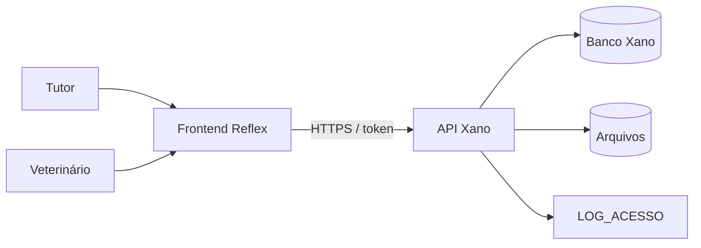
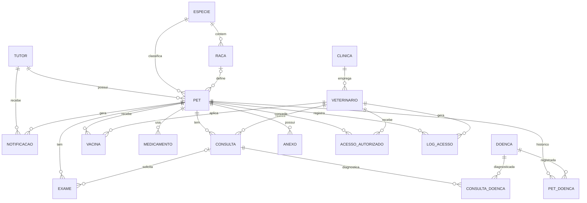
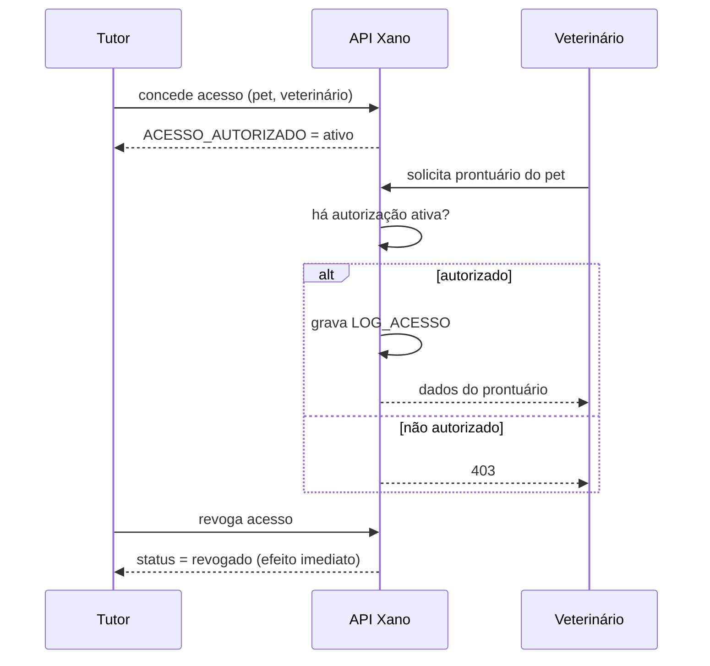

# VetTech — Project Overview

> Prontuário digital para pets: o histórico de saúde do animal acompanha o pet por toda a vida, independentemente de clínica, cidade ou veterinário.

**Fonte de verdade:** o modelo de dados (DER) e o xanoscript em `xano/`. Toda alteração na modelagem deve ser refletida **tanto no diagrama quanto no xanoscript**, mantendo consistência entre documentação técnica e implementação. O DER e o Xano servem de base para o desenvolvimento do backend e do frontend.

---

## Sumário

1. [Visão geral](#1-visão-geral)
2. [Problema](#2-problema)
3. [Objetivos](#3-objetivos)
4. [Usuários e perfis](#4-usuários-e-perfis)
5. [Escopo](#5-escopo)
6. [Requisitos funcionais](#6-requisitos-funcionais)
7. [Regras de negócio](#7-regras-de-negócio)
8. [Arquitetura e stack tecnológica](#8-arquitetura-e-stack-tecnológica)
9. [Modelo de dados](#9-modelo-de-dados)
10. [Permissões e auditoria](#10-permissões-e-auditoria)
11. [Segurança, integridade e LGPD](#11-segurança-integridade-e-lgpd)
12. [Estratégia de desenvolvimento](#12-estratégia-de-desenvolvimento)
13. [Princípios de modelagem e desenvolvimento](#13-princípios-de-modelagem-e-desenvolvimento)
14. [Estrutura do repositório](#14-estrutura-do-repositório)
15. [Convenções para specs (OpenSpec)](#15-convenções-para-specs-openspec)
16. [Pontos em aberto](#16-pontos-em-aberto)
17. [Glossário](#17-glossário)

---

## 1. Visão geral

O VetTech é uma plataforma web de prontuário digital para pets. Ela centraliza o histórico médico completo de cada animal em um único ambiente seguro e acessível, atendendo **clínicas veterinárias, veterinários e tutores**.

O sistema conecta **tutores** e **veterinários**: o tutor é dono dos dados do animal e decide quem pode acessá-los. O histórico de saúde do pet acompanha o animal ao longo de toda a vida, independentemente de mudanças de clínica, cidade ou veterinário responsável.

## 2. Problema

Atualmente, o histórico médico de pets está fragmentado entre cadernetas de papel, arquivos físicos e sistemas isolados de cada clínica. Consequências:

- repetição desnecessária de exames;
- risco de erro médico por falta de informação (ex.: alergias não comunicadas);
- perda de continuidade no acompanhamento de doenças crônicas;
- dificuldade do tutor em controlar vacinas e medicações.

## 3. Objetivos

- Centralizar o histórico médico completo de cada pet em um único sistema.
- Garantir que o prontuário acompanhe o pet independentemente da clínica atendida.
- Reduzir riscos médicos causados por falta de informação nos atendimentos.
- Dar ao tutor controle sobre quem acessa os dados do seu animal.
- Facilitar o acompanhamento de vacinas, medicações e retornos por meio de lembretes automáticos.

## 4. Usuários e perfis

| Perfil | Necessidade | Pode |
|---|---|---|
| **Tutor** | Organização e controle sobre a saúde dos seus pets | Cadastrar e gerenciar os próprios pets; conceder/revogar acesso a veterinários; consultar o histórico de acessos; receber notificações; exportar PDF |
| **Veterinário** | Acesso rápido e confiável ao histórico do paciente | Registrar consultas, vacinas e diagnósticos **somente** em pets com autorização ativa |
| **Clínica** | Agrupar veterinários | Empregar vários veterinários. **Não acessa prontuários diretamente**: o acesso é sempre individual, por veterinário autorizado |

**Clínicas de emergência/plantão** se beneficiam do acesso rápido a informações críticas em situações urgentes, atendidas pelo mesmo fluxo de autorização.

**Administração do sistema:** pode consultar quem acessou os dados e quando (RN08). O perfil ainda não está descrito (ver [Pontos em aberto](#16-pontos-em-aberto)).

## 5. Escopo

### Dentro do escopo
Aplicação web com:
- cadastro de tutores, veterinários e clínicas;
- perfil completo do pet;
- registro de consultas, exames, vacinas, medicamentos e doenças;
- sistema de permissões de acesso;
- log de auditoria;
- notificações automáticas;
- exportação de relatório em PDF.

### Fora do escopo inicial (evolução futura)
- Módulo de pagamento
- Telemedicina em vídeo
- Aplicativo mobile nativo

## 6. Requisitos funcionais

| # | Funcionalidade | Descrição |
|---|---|---|
| RF01 | Cadastro e autenticação | Tutores e veterinários se cadastram e fazem login |
| RF02 | Perfil do pet | Dados, foto, espécie, raça |
| RF03 | Histórico médico | Consultas, exames e diagnósticos |
| RF04 | Carteira de vacinação | Vacinas aplicadas com alerta de reforço |
| RF05 | Controle de medicamentos | Contínuos, vermífugo, antipulgas/carrapatos e outros |
| RF06 | Registro de doenças | Diagnóstico pontual (por consulta) e histórico consolidado (por pet) |
| RF07 | Permissões | Tutor autoriza e revoga acesso de veterinários |
| RF08 | Log de auditoria | Quem acessou, editou ou exportou dados |
| RF09 | Notificações automáticas | Vacina, retorno, medicamento |
| RF10 | Exportação | Relatório PDF do histórico completo |

## 7. Regras de negócio

### Acesso
- **RN01** Apenas o tutor autoriza ou revoga o acesso de um veterinário ao prontuário do seu pet.
- **RN02** O veterinário só visualiza, edita ou exporta dados de pets aos quais foi explicitamente autorizado (autorização com status "ativo").
- **RN03** Ao revogar, o veterinário perde o acesso imediatamente.
- **RN04** Um pet pode ter vários veterinários autorizados ao mesmo tempo.
- **RN05** O tutor só visualiza e gerencia os pets vinculados a ele.

### Auditoria
- **RN06** Toda visualização, edição ou exportação gera registro em `LOG_ACESSO` (data, veterinário, pet, ação).
- **RN07** O log não pode ser editado nem apagado por nenhum usuário (trilha de auditoria imutável).
- **RN08** O tutor e a administração do sistema podem consultar quem acessou os dados e quando.

### Unicidade e integridade
- **RN09** Tutor: CPF e e-mail únicos (não pode haver dois cadastros com o mesmo CPF ou e-mail).
- **RN10** Veterinário: CRMV único, garantindo que é um profissional habilitado.
- **RN11** Clínica: CNPJ único.
- **RN12** Espécie: nome único (ex.: não pode haver duas entradas para "Cachorro").
- **RN13** Toda raça pertence a exatamente uma espécie; o pet não pode receber raça de outra espécie (ex.: "Labrador" não pode ser associado a "Gato").
- **RN14** A raça do pet é opcional (em branco = SRD, sem raça definida).
- **RN15** Todo pet pertence a exatamente um tutor responsável.
- **RN16** O histórico do pet nunca é apagado, mesmo com mudança de clínica, veterinário ou tutor.
- **RN17** O sistema suporta múltiplas clínicas e veterinários por pet sem duplicar o histórico.

### Registros clínicos
- **RN18** Toda consulta tem um pet e um veterinário responsável.
- **RN19** Um exame sempre pertence a um pet e pode (ou não) estar ligado a uma consulta (exame avulso). Uma consulta pode gerar um ou mais exames.
- **RN20** Toda vacina tem pet e veterinário aplicador; guarda a data de aplicação e, quando aplicável, a data prevista da próxima dose (base para lembretes automáticos).
- **RN21** Medicamento tem tipo: contínuo (sem data de fim definida), vermífugo, antipulgas/carrapatos ou outro. Todo medicamento está vinculado a um pet.
- **RN22** Doença é um cadastro genérico e reutilizável (ex.: "Dermatite"), ligada a consultas (diagnóstico pontual) e a pets (histórico consolidado, com status).
- **RN23** Um anexo pertence a um pet (foto, receita, laudo ou outro) e não depende de consulta ou exame para existir.
- **RN24** Toda notificação pertence a um pet e ao tutor que a recebe; refere-se a um evento (vacina, medicamento, retorno) por referência genérica; controla se foi enviada e se foi visualizada.

## 8. Arquitetura e stack tecnológica

| Camada | Tecnologia | Responsabilidade |
|---|---|---|
| Banco de dados | Xano | Tabelas, relacionamentos, integridade referencial |
| Backend / API | Xano (xanoscript) | Regras de negócio, autenticação, validações, autorização |
| Frontend | Python + Reflex | Interface web responsiva, com dashboards distintos para tutor e veterinário |
| Arquivos | URL/arquivo vinculado ao pet | Anexos: exames, laudos, receitas, fotos |

## 9. Modelo de dados

### Diagrama entidade-relacionamento

### Entidades

Campos de chave primária (`id`) e chaves estrangeiras são implícitos; as FKs seguem os relacionamentos descritos em cada entidade.

#### TUTOR
- **Campos:** nome, CPF (único), e-mail (único), telefone, endereço, senha (hash).
- **Regras:** CPF e e-mail únicos; só ele concede/revoga acesso de veterinários aos seus pets; só visualiza e gerencia os pets vinculados a ele.
- **Relaciona-se com:** PET (1:N), NOTIFICACAO (1:N).

#### VETERINARIO
- **Campos:** nome, CRMV (único), especialidade, e-mail, telefone, senha (hash), clínica.
- **Regras:** CRMV único; só acessa prontuário de pet com autorização ativa; pode realizar consultas, aplicar vacinas e registrar diagnósticos em qualquer pet ao qual tenha acesso autorizado.
- **Relaciona-se com:** CLINICA (N:1), CONSULTA (1:N), VACINA (1:N), ACESSO_AUTORIZADO (1:N), LOG_ACESSO (1:N).
- **Observação:** a obrigatoriedade do vínculo com clínica está em aberto (ver [Pontos em aberto](#16-pontos-em-aberto)).

#### CLINICA
- **Campos:** nome, CNPJ (único), endereço, telefone.
- **Regras:** CNPJ único; pode empregar vários veterinários; não acessa diretamente o prontuário dos pets (acesso sempre individual, por veterinário autorizado).
- **Relaciona-se com:** VETERINARIO (1:N).

#### ESPECIE
- **Campos:** nome (único).
- **Regras:** padronizada no sistema (cachorro, gato, ave etc.); uma espécie contém várias raças.
- **Relaciona-se com:** RACA (1:N), PET (1:N).

#### RACA
- **Campos:** nome, espécie.
- **Regras:** pertence obrigatoriamente a uma única espécie; não pode ser vinculada a pet de espécie diferente.
- **Relaciona-se com:** ESPECIE (N:1), PET (1:N).

#### PET
- **Campos:** nome, espécie, raça (opcional), sexo, data de nascimento, peso, cor da pelagem, nº de microchip (opcional, quando houver), foto, tutor.
- **Regras:** exatamente um tutor responsável; pode ter vários veterinários autorizados, sempre mediante permissão do tutor; acumula ao longo do tempo consultas, exames, vacinas, medicamentos e diagnósticos; histórico nunca é apagado.
- **Relaciona-se com:** TUTOR, ESPECIE, RACA (N:1); CONSULTA, EXAME, VACINA, MEDICAMENTO, PET_DOENCA, ANEXO, NOTIFICACAO, ACESSO_AUTORIZADO, LOG_ACESSO (1:N).

#### CONSULTA
- **Campos:** data, motivo do atendimento, diagnóstico do veterinário, observações adicionais, pet, veterinário.
- **Regras:** sempre vinculada a um pet e a um veterinário responsável; pode gerar um ou mais exames complementares; pode resultar no diagnóstico de uma ou mais doenças (via CONSULTA_DOENCA).
- **Relaciona-se com:** PET (N:1), VETERINARIO (N:1), EXAME (1:N), CONSULTA_DOENCA (1:N).

#### EXAME
- **Campos:** tipo, data, resultado, arquivo anexado (laudo, imagem, PDF), pet, consulta (opcional).
- **Regras:** sempre vinculado a um pet; pode ou não estar vinculado a uma consulta (exame avulso); o modelo prevê no mínimo 1 arquivo anexado (ver [Pontos em aberto](#16-pontos-em-aberto)).
- **Relaciona-se com:** PET (N:1), CONSULTA (N:1, opcional).

#### VACINA
- **Campos:** nome, data de aplicação, lote, data da próxima dose (opcional), pet, veterinário.
- **Regras:** vinculada a um pet e ao veterinário aplicador; armazena a data prevista da próxima dose, quando aplicável, para gerar lembretes automáticos.
- **Relaciona-se com:** PET (N:1), VETERINARIO (N:1), NOTIFICACAO (1:N, indireta via referência).

#### MEDICAMENTO
- **Campos:** nome, dosagem, frequência, período de uso, tipo (contínuo, vermífugo, antipulgas/carrapatos, outro), pet.
- **Regras:** vinculado a um pet; tipo contínuo não tem data de fim definida.
- **Relaciona-se com:** PET (N:1).

#### DOENCA
- **Campos:** nome, descrição, tipo, gravidade.
- **Regras:** cadastro genérico e reutilizável entre pets e consultas.
- **Relaciona-se com:** CONSULTA (N:N via CONSULTA_DOENCA), PET (N:N via PET_DOENCA).

#### CONSULTA_DOENCA (associativa)
Liga CONSULTA e DOENCA: representa o **diagnóstico pontual** feito em uma consulta específica.

#### PET_DOENCA (associativa)
Liga PET e DOENCA: representa o **histórico consolidado** do pet, com **status** (ativa, em tratamento, curada, controlada). Permite que o tutor e qualquer veterinário autorizado conheçam rapidamente as condições de saúde do animal.

#### ANEXO
- **Campos:** tipo (foto, receita, laudo, outro), arquivo, pet.
- **Regras:** vinculado sempre a um pet; independe de consulta ou exame para existir.
- **Relaciona-se com:** PET (N:1).

#### NOTIFICACAO *(opcional no escopo do modelo, mas prevista em RF09)*
- **Campos:** pet, tutor, referência genérica ao evento (vacina, medicamento, retorno), enviada (sim/não), visualizada (sim/não).
- **Regras:** vinculada a um pet e ao tutor que deve recebê-la; controla envio e visualização.
- **Relaciona-se com:** PET (N:1), TUTOR (N:1).

#### ACESSO_AUTORIZADO
- **Campos:** pet, veterinário, status (ativo/revogado).
- **Regras:** só o tutor do pet cria, mantém ou revoga; um pet pode ter múltiplos veterinários autorizados simultaneamente; o veterinário só consulta, edita ou exporta enquanto o status for "ativo"; ao revogar, perde o acesso imediatamente.
- **Relaciona-se com:** PET (N:1), VETERINARIO (N:1).

#### LOG_ACESSO
- **Campos:** pet, veterinário, ação (visualização, edição, exportação), data.
- **Regras:** todo acesso de veterinário ao prontuário gera registro automaticamente; **imutável** (não pode ser editado nem apagado por nenhum usuário); permite ao tutor e à administração verificar quem acessou os dados e quando.
- **Relaciona-se com:** PET (N:1), VETERINARIO (N:1).

## 10. Permissões e auditoria

### Fluxo de autorização

### Matriz de acesso

| Recurso | Tutor (dono) | Veterinário autorizado | Veterinário sem autorização | Clínica |
|---|---|---|---|---|
| Dados do pet | Ler/editar | Ler | Nenhum | Nenhum |
| Consultas, exames, vacinas, medicamentos, doenças | Ler | Ler/registrar | Nenhum | Nenhum |
| Autorizações | Criar/revogar | Nenhum | Nenhum | Nenhum |
| LOG_ACESSO | Ler (do seu pet) | Nenhum | Nenhum | Nenhum |
| Exportar PDF | Sim | Sim (gera log) | Não | Não |

## 11. Segurança, integridade e LGPD

- Senhas armazenadas com **hash**, nunca em texto puro.
- Controle de acesso baseado em autorização explícita do tutor.
- Toda ação sensível (visualização, edição, exportação) é registrada em log, alinhada aos princípios da LGPD.
- Auditoria completa de acessos e alterações via `LOG_ACESSO`.
- Separação de responsabilidades entre perfis (tutor × veterinário).
- Integridade referencial garantida por chaves estrangeiras (FK) entre todas as entidades relacionadas.
- Validação adicional na camada de aplicação (ex.: a raça deve pertencer à espécie selecionada).
- Comunicação entre frontend e API via HTTPS com token de autenticação.

## 12. Estratégia de desenvolvimento

Desenvolvimento incremental por módulo, com spec driven development usando OpenSpec:

1. Modelagem do banco de dados (DER e xanoscript)
2. Definição da arquitetura (backend/frontend)
3. Desenvolvimento incremental por módulo: cadastro → prontuário → permissões → notificações
4. Testes com dados simulados (mock data)
5. Ajustes de usabilidade nas telas do tutor e do veterinário
6. Documentação final para entrega acadêmica

## 13. Princípios de modelagem e desenvolvimento

- Modelagem orientada ao usuário final: pet e tutor no centro do sistema, não a clínica.
- Normalização do banco de dados para evitar inconsistências (ex.: espécie/raça padronizadas).
- Uso de tabelas associativas para relacionamentos N:N (Pet–Doença, Consulta–Doença; a relação Pet–Veterinário é coberta por ACESSO_AUTORIZADO).
- Documentação incremental do modelo à medida que novas necessidades são identificadas.

## 14. Estrutura do repositório

| Caminho | Conteúdo |
|---|---|
| `vet_tech/` | Frontend em Reflex |
| `xano/` | xanoscript e artefatos do backend |
| `docs/` | Documentação e DER |
| `openspec/` | Especificações (inclui este `project.md`) |
| `rxconfig.py`, `reflex.lock`, `requirements.txt` | Configuração e dependências do Reflex |
| `AGENTS.md`, `CLAUDE.md` | Instruções para agentes de IA |

## 15. Convenções para specs (OpenSpec)

- Specs e mudanças devem referenciar os IDs de requisitos (`RF01`–`RF10`) e regras de negócio (`RN01`–`RN24`) deste documento.
- Qualquer mudança que altere entidades, campos ou relacionamentos deve atualizar o DER e o xanoscript no mesmo change.
- Regras de autorização (RN01–RN08) devem ser verificadas no backend (Xano), nunca apenas no frontend.
- Nomes de entidades seguem o DER (`TUTOR`, `PET`, `LOG_ACESSO`, etc.).

## 16. Pontos em aberto

1. **Anexos de exame:** a visão geral trata o arquivo como "quando aplicável", mas o modelo exige no mínimo 1 arquivo. Além disso, `ANEXO` está ligado apenas a `PET`, sem ligação direta a `EXAME`. Definir se haverá relação EXAME–ANEXO.
2. **Data de retorno:** há notificação de retorno, mas `CONSULTA` não tem campo de data de retorno.
3. **Perfil administrador:** o log é consultável pela "administração do sistema", mas não há perfil admin descrito.
4. **Cadastro de pet:** confirmar que apenas o tutor cadastra pets.
5. **Canal de notificação:** apenas dentro do sistema ou também por e-mail?
6. **Relação Pet–Veterinário:** coberta por `ACESSO_AUTORIZADO`; confirmar se basta ou se haverá vínculo clínico separado.
7. **Vínculo veterinário–clínica:** um dos documentos de origem marca o vínculo como opcional ("opcional: um veterinário está sempre vinculado a uma clínica"); definir se é obrigatório (veterinário autônomo?).
8. **Notificação:** um dos documentos de origem a marca como "(OPCIONAL)" na modelagem, enquanto RF09 a prevê como funcionalidade; confirmar prioridade.

## 17. Glossário

| Termo | Significado |
|---|---|
| Tutor | Responsável legal e dono dos dados do pet |
| Veterinário | Profissional habilitado (CRMV) que atende o pet e registra o prontuário |
| Clínica | Estabelecimento que emprega veterinários; não acessa prontuários diretamente |
| CRMV | Registro profissional do médico-veterinário |
| SRD | Sem raça definida |
| Prontuário | Histórico médico consolidado do pet |
| Diagnóstico pontual | Doença identificada em uma consulta específica |
| Histórico consolidado | Situação das doenças do pet ao longo do tempo |
| Exame avulso | Exame registrado sem vínculo a uma consulta |
| Autorização ativa | Permissão concedida pelo tutor que habilita o acesso do veterinário ao pet |
| DER | Diagrama entidade-relacionamento |
| LGPD | Lei Geral de Proteção de Dados |
| xanoscript | Linguagem de script do Xano usada para definir o backend |
